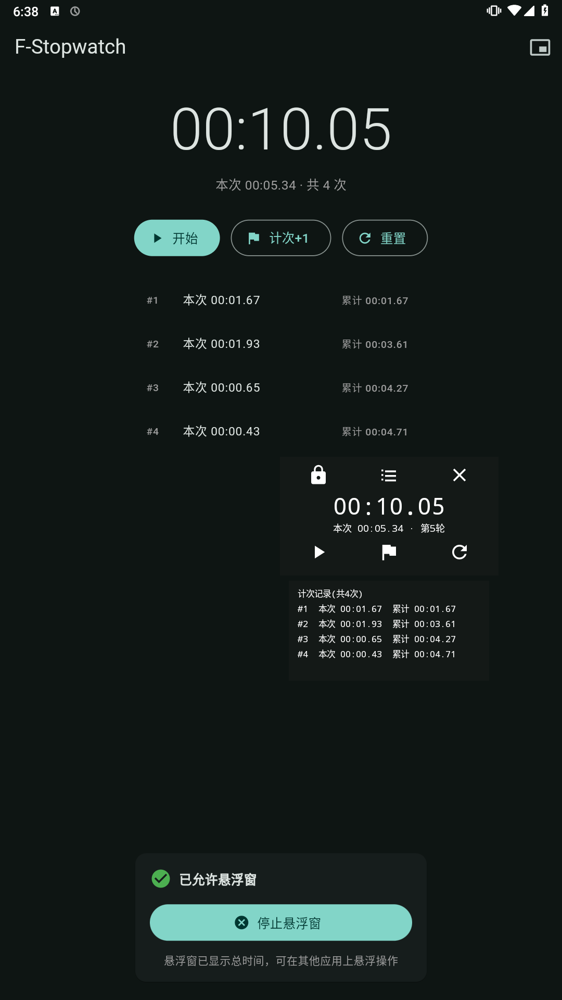
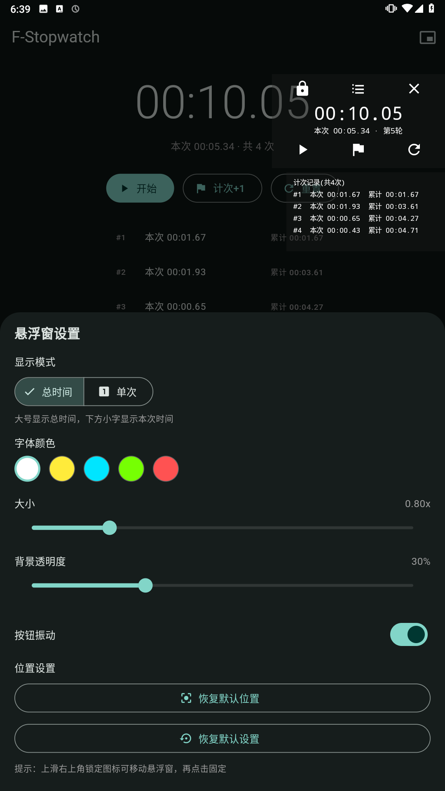

# F-Stopwatch（悬浮停表）

用 **Flutter（Dart 单代码库）** 开发的计时/停表应用，应用名**悬浮停表**，包名 **`com.f.s.f_stopwatch`**。

> 当前重点完善 **Android 端**；Windows / Web 端为主界面计时交互，功能待完善。
>
> 纯AI生成，看不懂代码（笑T_T）主要是自己平板刷题用，网上也没有找到符合需求的

## Android 功能

- **主页计时**：总时间 + 本次时间 + 计次列表；暂停/开始、计次+1、重置按钮。
- **悬浮窗**：显示总时间与本次计时，可悬浮在其他应用之上操作。
  - 顶部：锁定（拖动）、计次列表、关闭；底部：暂停/开始、计次+1、重置。
  - 两种显示模式：总时间模式（大号总时间 + 本次小字）/ 单次模式（当前轮次 + 第 N 次）。
  - 支持拖动/锁定；设置面板可调**字体颜色、大小、背景透明度、按钮振动**。
  - 配置与位置本地持久化，重启保留。
- **计时行为**：暂停后再开始从暂停点续跑；暂停时点"计次+1"不增加；按钮振动走原生 Vibrator，跨 ROM 稳定。

截图如下




### 悬浮窗注意点

- 首次进入需在系统设置允许「悬浮窗 / 显示在其他应用上层」权限，再点"启动悬浮窗"。
- 悬浮窗颜色/大小/透明度/模式等配置在首页右上角📌「浮窗设置」。
- 从最近任务上滑划掉 app 会杀进程、悬浮窗与计时一并停止；普通切后台不影响。

## 目录结构

```
lib/
  main.dart                  # 按平台分发入口
  stopwatch_model.dart       # 共享计时/停表核心模型
  format.dart                # 时间格式化
  overlay_bridge.dart        # Android 悬浮窗双向通道封装
  src/android/android_app.dart
  src/windows/windows_app.dart
  src/web/web_app.dart
android/app/src/main/...     # MainActivity、OverlayService(悬浮窗)、Manifest
web/                         # Web 脚手架
```

## 打包与调试（Android）

> 环境变量按本机实际情况设置（示例为本机路径，一次会话内生效）：

```powershell
$env:ANDROID_HOME='D:\AndriodSDK'
$env:ANDROID_SDK_ROOT='D:\AndriodSDK'
$env:JAVA_HOME='D:\JDK\jdk21'
$env:PATH="$env:JAVA_HOME\bin;$env:PATH"
```

**1) 连接设备/模拟器**

```powershell
adb devices   # 例如 emulator-7554  device 即连接成功
```

**2) 调试运行（改代码热重载）**

```powershell
flutter run -d <device-id>
# 运行中输入 r 热重载、R 热重启、q 退出
```

**3) 打 APK**

```powershell
flutter build apk --debug      # 调试包，开发用
flutter build apk --release    # 发布包
```

> **体积说明**：debug 包含整套 JIT 产物且打多 CPU 架构，通常 100MB+，仅开发用；发布走 release，单 arm64 架构实测约 15-16MB：
>
> ```powershell
> flutter build apk --release --target-platform android-arm64   # 日常真机推荐
> flutter build apk --release --split-per-abi                    # 按架构拆分发市场
> ```
>
> release 使用 `android/key.properties` 配置的正式签名；未配置时回退 debug 签名（见下节）。

**4) 安装并启动**

```powershell
adb install -r build\app\outputs\flutter-apk\app-debug.apk
adb shell "am start -n com.f.s.f_stopwatch/.MainActivity"
```

**5) 签名（keystore）**

- `android/keystore.jks` 与 `android/key.properties` **不入库**（已在 `android/.gitignore` 排除），请自行备份。
- `android/key.properties` 格式：

  ```
  storeFile=keystore.jks
  storePassword=<密码>
  keyAlias=f_stopwatch
  keyPassword=<密码>
  ```

  存在该文件时 release 自动使用正式签名；不存在则回退 debug 签名。
- 重新生成 keystore：

  ```powershell
  keytool -genkeypair -v -keystore android\keystore.jks -alias f_stopwatch -keyalg RSA -keysize 2048 -validity 10000
  ```

## 五、Windows / Web（待完善）

- **Windows**：主窗口计时 + 自定义全局热键（F2 暂停/开始、F3 计次+1），热键设置见首页「热键设置」。
  - 需 Visual Studio 2022（C++ 桌面开发工作负载）。运行：`flutter run -d windows`。
- **Web**：功能与主端一致的计时交互，不绑热键，用于快速调试 UI/逻辑。
  - 调试：`flutter run -d web-server --web-port 8080`，访问 <http://localhost:8080。>
  - 发布：`flutter build web`，产物在 `build\web`，部署到任意静态服务器即可。
  - Web 无原生悬浮窗/通道功能。

